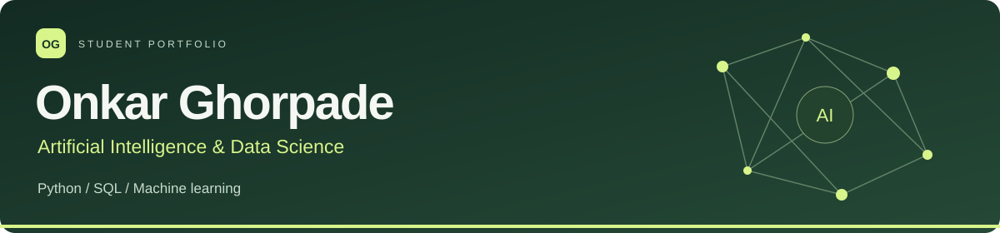
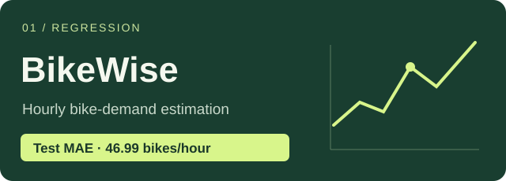
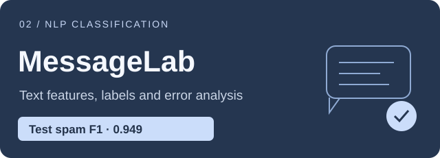

  <a href="https://www.linkedin.com/in/onkar-ghorpade-3b1162376/">LinkedIn</a> &nbsp;·&nbsp;
  <a href="https://www.kaggle.com/OnkarGhorpade">Kaggle</a> &nbsp;·&nbsp;
  <a href="mailto:oghorpade060@gmail.com">Email</a> &nbsp;·&nbsp;
  <a href="https://github.com/oghorpade060-eng/onkar-ghorpade/blob/main/docs/PROJECT_INDEX.md">Project & guide index</a>

  
  
  
  
  
  

## About me

I'm **Onkar Ghorpade**, a second-year **Artificial Intelligence & Data Science student** at Sanjivani. I'm learning Python, SQL and machine learning by building small applications, checking their results and writing down what I understand.

My current focus is practical: work with a dataset, choose a fair evaluation, make the result usable, and explain where it can fail.

**Building skills step by step: Python, SQL, machine learning, then deep learning and LLM applications.**

## Currently working on

- Python fundamentals, NumPy and pandas, with weekly exercises in [python-practice](https://github.com/oghorpade060-eng/python-practice)
- Adding screenshots, baselines and confusion matrices to my projects
- Next: PyTorch basics, then retrieval and RAG (learning goals, not completed work)

## Selected projects

<table>
<tr>
<td width="50%" valign="top">
  
  
Estimate hourly bike rentals from time and weather. Compare three models using a chronological split, then explore scenarios in a Flask dashboard.

  
<strong>Python · pandas · scikit-learn · Flask</strong>

  <a href="https://github.com/oghorpade060-eng/BikeWise">Code & setup</a> · <a href="https://github.com/oghorpade060-eng/onkar-ghorpade/blob/main/docs/LEARNING_GUIDE.md">Concepts & notes</a>
</td>
<td width="50%" valign="top">
  
  
Classify English SMS messages, inspect word signals and compare precision with recall. Duplicate messages are removed before splitting.

  
<strong>Python · TF–IDF · scikit-learn · Flask</strong>

  <a href="https://github.com/oghorpade060-eng/MessageLab">Code & setup</a> · <a href="https://github.com/oghorpade060-eng/onkar-ghorpade/blob/main/docs/MESSAGELAB_LESSON.md">Concepts & notes</a>
</td>
</tr>
<tr>
<td width="50%" valign="top">
  <h3><a href="https://github.com/oghorpade060-eng/LibraryLens">LibraryLens · SQL analytics</a></h3>
  
Six SQL reports covering borrowing patterns, overdue loans and inventory. Uses <strong>366 synthetic loans</strong>, joins, CTEs, window functions and boundary-date tests. Generates an offline HTML dashboard and CSV exports using only Python's standard library.

  
<strong>Python · SQLite · SQL · Data analysis</strong>

  <a href="https://github.com/oghorpade060-eng/LibraryLens">Code, setup & exercises</a>
</td>
<td width="50%" valign="top">
  <h3><a href="https://github.com/oghorpade060-eng/python-practice">Python practice</a></h3>
  
Weekly Python exercises and a 26-week study plan. Each week I write small programs, run them and note what I learned.

  
<strong>Python · Practice · Learning log</strong>

  <a href="https://github.com/oghorpade060-eng/python-practice">Open repository</a>
</td>
</tr>
</table>

ML results are measured on historical holdouts. LibraryLens uses synthetic data. The apps run locally; each repository includes source code, setup commands, tests and limitations.

## Project screenshots

<table>
<tr>
<td width="33%"> <b>BikeWise</b> dashboard</td>
<td width="33%"> <b>MessageLab</b> app</td>
<td width="33%"> <b>LibraryLens</b> dashboard</td>
</tr>
</table>

## Other repositories

| Repository | What it covers | Context |
| :--- | :--- | :--- |
| [Library Management Platform](https://github.com/oghorpade060-eng/library-management-platform) | Flask API, Docker, Jenkins and Kubernetes | DevOps coursework; the repository README retains upstream source references. |
| [Incredible Indian Heritage](https://github.com/oghorpade060-eng/ADP-PROJECT) | HTML, CSS and content pages | Application Development Practices project. |
| [YatriFlow](https://github.com/oghorpade060-eng/yatrifliow) | React, TypeScript and Supabase authentication | Fork of [omlaware07-code/yatrifliow](https://github.com/omlaware07-code/yatrifliow); source credited. |

## What I'm learning

| Area | Current practice |
| :--- | :--- |
| Python & data | Functions, NumPy, pandas, cleaning and visualization |
| Machine learning | Regression, classification, baselines and leakage prevention |
| SQL | Joins, grouping, CTEs, window functions and date handling |
| Applications | Flask, JavaScript, React and TypeScript |
| Development | Git, tests, GitHub Actions, Docker and CI/CD |

Next: build a stronger foundation in PyTorch, then study retrieval and RAG. These are learning goals, not completed projects or professional experience.

## AI & Data Science simplified

| Idea | In simple terms |
| :--- | :--- |
| Regression | Predict a number, such as hourly bike rentals. |
| Classification | Choose a category, such as ham or spam. |
| Data leakage | Let information from the answer or evaluation data influence training. |
| SQL analytics | Use queries to answer clear questions about related tables. |

[More concepts with examples and Marathi explanations →](https://github.com/oghorpade060-eng/onkar-ghorpade/blob/main/docs/AI_DS_SIMPLIFIED.md)

## Featured guides

- [Project setup and guide index](https://github.com/oghorpade060-eng/onkar-ghorpade/blob/main/docs/PROJECT_INDEX.md)
- [26-week study plan with official references](https://github.com/oghorpade060-eng/python-practice/blob/main/STUDY_PLAN.md)
- [Week 1: Python practice](https://github.com/oghorpade060-eng/python-practice/blob/main/WEEK_01.md)
- [BikeWise and MessageLab: concepts and metrics](https://github.com/oghorpade060-eng/onkar-ghorpade/blob/main/docs/LEARNING_GUIDE.md)

## Connect with me

[LinkedIn](https://www.linkedin.com/in/onkar-ghorpade-3b1162376/) · [Kaggle](https://www.kaggle.com/OnkarGhorpade) · [oghorpade060@gmail.com](mailto:oghorpade060@gmail.com)

Source and dataset credits are included in the project documentation. The learning log is for recording work I have run, changed and can explain.
